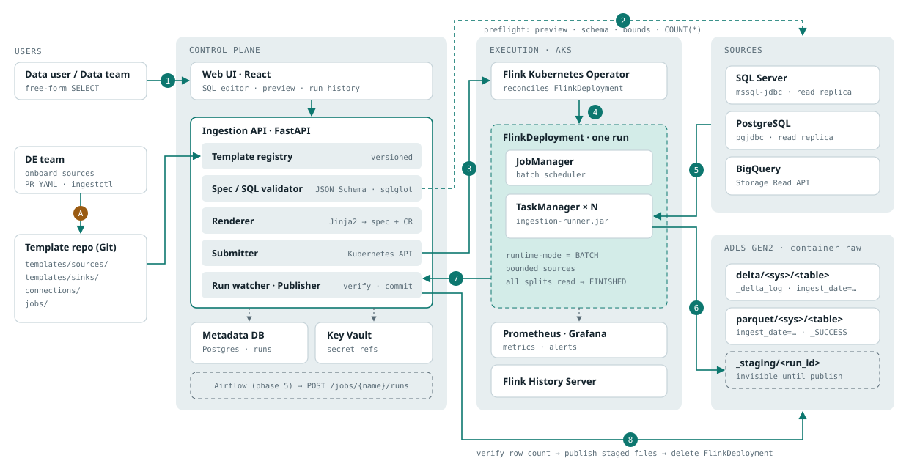

# data-onboarding-ingestion

Self-service ingestion platform built on Apache Flink. The DE team onboards a source once from a YAML template (SQL Server, PostgreSQL, MySQL, BigQuery, REST APIs). Users then define a job in the Web UI (or as YAML) with a free-form read-only `SELECT`; each job becomes its own Airflow DAG, and every run is compiled into a bounded Flink batch job. The job lands Parquet or Delta on ADLS Gen2, partitioned by `ingest_date`, and every run is verified by row-count reconciliation before it is published.



## Status

**Phase 1: Non-prod environment, Web UI and Airflow.** The Web UI runs against a mock API; the non-prod Compose stack is in `infrastructure/`. See the [roadmap](docs/roadmap.md).

## Repository layout

```
.devcontainer/            GitHub Codespaces definition (starts non-prod)
.github/                  CI workflows (Phase 3)
code/                     everything the platform team writes and deploys
  ui/                     Web UI (React)
  control-plane/          shared library, Ingestion API (FastAPI), ingestctl CLI
  airflow/                DAG factory; mounted on Airflow at dags/ingestion/
  runner/                 generic Flink job (PyFlink)
  templates/              versioned source and sink templates, JSON Schemas
    sources/  sinks/  runtime/  schemas/
pipelines/                YAML owned by users and the DE team, one file per object
  connections/            onboarded sources (connections/<name>.yaml)
  jobs/                   ingestion jobs; jobs/<name>.yaml becomes DAG ingest__<name>
infrastructure/           Dockerfiles and Docker Compose per environment
  docker/  non-prod/  prod/
  non-prod/example-sources/  test sources for demos (SQL Server, PostgreSQL, MySQL, REST API); non-prod only
docs/                     architecture, roadmap, configuration spec, ADRs
```

Details and reasons: [architecture §12](docs/architecture.md#12-repository-layout).

## Getting started

Open the repository in GitHub Codespaces (4-core / 16 GB machine). The non-prod stack starts by itself: Web UI on port 3000, Airflow on 8080, Flink on 8081. See [infrastructure/README.md](infrastructure/README.md) to run it elsewhere.

`pipelines/` starts empty, as in a new prod. To demo the platform, start the example sources and onboard one step by step (connection → job → DAG → run): [infrastructure/non-prod/example-sources/README.md](infrastructure/non-prod/example-sources/README.md).

## Documentation

| Document | Content |
|---|---|
| [Architecture](docs/architecture.md) | Components, run lifecycle, completion detection, lake layout |
| [Roadmap](docs/roadmap.md) | Phases, checklists, exit criteria, open questions |
| [Configuration spec](docs/configuration-spec.md) | `SourceTemplate`, `SinkTemplate`, `Connection`, `IngestionJob` |
| [ADRs](docs/adr/README.md) | Architecture decisions and their trade-offs |
| [PostgreSQL](docs/postgresql.md) | The `airflow` and `platform` databases: how to connect and check every table |
| [Contributing](CONTRIBUTING.md) | Conventions for this repository |

## Scope (v1)

- Sources: SQL Server, PostgreSQL, MySQL, BigQuery; REST APIs through a Redpanda landing topic ([ADR-0015](docs/adr/0015-rest-api-source-via-redpanda.md))
- Destination: Azure Data Lake Storage Gen2
- Formats: Parquet, Delta Lake
- Execution: Apache Flink 1.20 in batch mode on a standalone session cluster (JobManager on VM 1, TaskManagers on VM 2)
- Orchestration: Apache Airflow, one DAG `ingest__<name>` per job file; on-demand runs from the UI or CLI
- Environments: non-prod on GitHub Codespaces (one Docker Compose project), prod on two VMs; container definitions in `infrastructure/`
