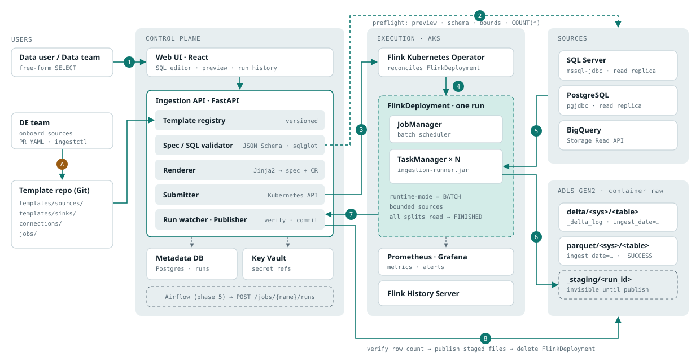
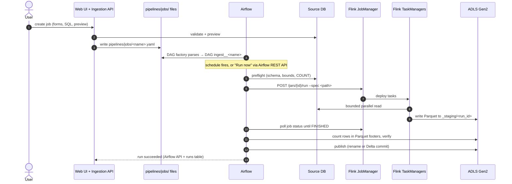

# Architecture

Status: **Draft (Phase 0)** · Last updated: 2026-10-22

This document describes the target architecture of the self-service ingestion platform. Decisions with meaningful trade-offs are recorded separately as [ADRs](adr/README.md); this document links to them instead of repeating the reasoning.

## 1. Context and goals

Data consumers (analysts, the data team, other DE teams) regularly need a copy of an operational table or query result in the data lake. Today each request becomes a hand-written pipeline. The platform replaces that with a declarative flow:

1. The DE team onboards a source once (a `Connection`).
2. A user writes a `SELECT` query against that connection and picks a destination, in the Web UI or as a YAML file.
3. The job becomes its own Airflow DAG. Each run compiles the request into a bounded Apache Flink batch job, runs it, verifies the result, and publishes it to the lake.

The design is inspired by Grab's [one-click ingestion platform](https://engineering.grab.com/one-click-data-ingestion-platform-with-apache-flink), scoped down to batch snapshots for v1.

### Goals (v1)

- Sources: **SQL Server**, **PostgreSQL**, **BigQuery**.
- Destination: **Azure Data Lake Storage Gen2** (Blob Storage with hierarchical namespace).
- Formats: **Parquet** and **Delta Lake**, partitioned by `ingest_date`.
- Users can write **free-form read-only SQL** (joins, CTEs, aggregations).
- Every source type and sink type is described by a **versioned YAML template**; adding a new source of an existing type requires no code.
- A job **stops by itself** when the source data is exhausted, and a run is only marked successful after **row-count verification**.
- Every job is a **YAML file**. The Web UI writes the same files the DE team can edit and review in Git.

### Non-goals (v1)

- Change data capture and streaming ingestion.
- A custom scheduler: Airflow schedules and orchestrates runs ([ADR-0008](adr/0008-airflow-dag-per-job.md)).
- Kubernetes: v1 runs on virtual machines with Docker Compose ([ADR-0007](adr/0007-flink-standalone-session-cluster.md)).
- Transformations beyond what the user's `SELECT` expresses.
- Sinks other than ADLS Gen2 (S3 and GCS are planned; the design keeps them pluggable).

## 2. Overview



| Plane | Responsibility | Runs on (prod) |
|---|---|---|
| **Control plane** | Web UI, Ingestion API: templates, validation, preview, YAML files | VM 1 |
| **Orchestration** | Airflow: one DAG per job; preflight, render, submit, wait, verify, publish | VM 1 |
| **Execution plane** | Flink 1.20 standalone session cluster | JobManager on VM 1, TaskManagers on VM 2 |
| **Storage plane** | Sources (read-only) and the lake (ADLS Gen2) | Existing infrastructure |

In non-prod every component runs in one Docker Compose project on GitHub Codespaces ([ADR-0009](adr/0009-environments.md)).

The control plane and Airflow never move data. Flink never decides whether a run succeeded.

## 3. Components

### 3.1 Web UI

React, Vite, TypeScript and shadcn/ui (Base UI), with a CodeMirror 6 editor for SQL and YAML. Three main screens:

| Screen | Content |
|---|---|
| **Connections** | List of connections; "New connection" form; "Test connection" |
| **New job** | Wizard: Source (connection, SQL editor, validation, preview) → Sink → Schedule → Review (form and live YAML side by side) → Save or Export YAML |
| **Jobs** | Latest runs, "Run now", links to the job's Airflow DAG and the Flink web UI, invalid files flagged |

Forms are generated from the parameter declarations of each template by a small renderer in the UI, so a new template appears without frontend changes. The UI holds no business logic; it calls the Ingestion API. Until the API exists it runs against an in-browser mock with the same interface.

The UI is kept small because non-prod runs in Codespaces: CodeMirror instead of Monaco, no form library, and the editor and form pages are lazy-loaded.

UI references: Airbyte (connection setup with a connection test), Kestra (form and YAML side by side), Apache StreamPark (job list linking to the native Flink web UI).

### 3.2 Ingestion API

Python 3.12 / FastAPI. Business logic lives in a shared library in `code/control-plane/` that the API, the `ingestctl` CLI and the Airflow tasks all use.

| Module | Responsibility |
|---|---|
| **Template registry** | Loads `code/templates/**`, keeps every version, exposes JSON Schemas |
| **Spec / SQL validator** | Validates YAML against JSON Schema; parses and checks user SQL with `sqlglot` ([ADR-0005](adr/0005-free-form-sql.md)) |
| **Config store** | Reads and writes `pipelines/connections/<name>.yaml` and `pipelines/jobs/<name>.yaml`; enforces file name = `name` and immutable names |
| **Preview / preflight** | Preview, schema introspection, partition bounds and `COUNT(*)` against the source |
| **Renderer** | Jinja2: template + connection + job + preflight results → resolved job spec and Flink submission request |
| **Flink client** | Starts the PyFlink runner, polls and cancels jobs through the Flink REST API |
| **Publisher** | Verifies row counts and atomically publishes staged output ([ADR-0004](adr/0004-lake-layout-and-delta-commit.md)) |
| **Airflow client** | Triggers DAG runs ("Run now") and reads run status through the Airflow REST API |

`ingestctl` wraps the same library (`validate`, `preflight`, `render`, `submit`, `run`, `status`) so the DE team can work entirely from Git.

### 3.3 Airflow

Airflow 3 orchestrates every run ([ADR-0008](adr/0008-airflow-dag-per-job.md)):

- One factory file, `code/airflow/dags/ingestion_dag_factory.py`, registers **one DAG per job file**, with DAG id **`ingest__<name>`**.
- Tasks: preflight → render → submit → wait → verify → publish, each calling the shared library. `wait` is deferrable and polls the Flink REST API.
- `max_active_runs=1` per DAG; pool `conn__<connection>` limits concurrent runs per connection; a slot pool limits the total parallelism sent to Flink.
- On-demand runs from the UI or the CLI trigger the same DAG through the Airflow REST API.
- The `publish` task emits an Airflow Asset for the table root URI, so downstream DAGs (for example dbt in another repository) run when the table is published.
- Airflow is shared: each repository owns `dags/<repo>/` and `projects/<repo>/` on the Airflow host; this repository's DAGs live in `dags/ingestion/`.

### 3.4 Metadata DB

One PostgreSQL 16 instance holds two databases: Airflow's metadata database and the platform database. Connections, jobs and templates are YAML files, versioned in Git, not database tables. The platform database records run details from Phase 5:

| Table | Content |
|---|---|
| `runs` | One row per run, keyed by DAG id and run id: `ingest_date`, Flink job id, expected rows, written rows, output paths, resolved spec, error |
| `run_events` | Append-only state transitions and diagnostics |

### 3.5 Ingestion runner

A single generic **PyFlink** program ([ADR-0010](adr/0010-pyflink-runner.md)), written with the Table API and Flink SQL only, so the job itself runs entirely in the JVM. It runs on the JobManager, the only Flink node that needs Python; connectors, JDBC drivers and the `flink-azure-fs-hadoop` plugin are part of the Flink image. It receives the path to a resolved job spec, never a template, and:

1. Resolves secret references when it builds the job graph (§3.7).
2. Declares the source with `CREATE TABLE`: the Flink JDBC table connector over a table (**table mode**) or over the user's query as a derived table (**query mode**), with partitioned scans in both; or the BigQuery connector.
3. Adds audit columns `ingest_date`, `_ingest_run_id`, `_ingested_at` as SQL literals.
4. Writes Parquet into the run's staging location with an `INSERT ... SELECT` into the filesystem connector.

The runner writes no manifest: the publisher counts written rows from the Parquet footers.

### 3.6 Flink session cluster

A standalone session cluster ([ADR-0007](adr/0007-flink-standalone-session-cluster.md)) with `execution.runtime-mode: BATCH` for every run:

- **JobManager** on VM 1: REST API and web UI on port 8081, RPC and blob server for the TaskManagers.
- **TaskManagers** on VM 2, each with a fixed number of task slots shared by all runs.
- Each run is one Flink job started with `POST /jars/{flink-python}/run`, entry class `org.apache.flink.client.python.PythonDriver`, arguments `-py <runner>/main.py --spec <path>`. Resolved specs are written to a run directory shared by Airflow and the JobManager on VM 1.

### 3.7 Secrets and identity

- Connections store secret references, never values:
  - `env://<VAR>` in non-prod: values come from Codespaces secrets or a local `.env` file, injected into the API, Airflow and Flink containers.
  - `kv://<vault>/<secret>` in prod: Azure Key Vault, accessed with the VM's managed identity if the VMs run on Azure (open question, Phase 6).
- The runner resolves references when it builds the job graph. Secret values never appear in program arguments, the Flink web UI or Airflow logs.
- Every source connection uses a dedicated **read-only** database principal. This is the primary security control; SQL validation is a second layer.
- ADLS Gen2 access: a service principal from Codespaces secrets in non-prod; managed identity in prod (to be confirmed).
- UI sign-in with Entra ID SSO before the prod UI is exposed (Phase 6).

### 3.8 Observability

- Airflow UI per DAG: schedule, run history, task logs, retries.
- Flink web UI on the JobManager for running and recently finished jobs.
- Flink metrics through the Prometheus reporter; Grafana dashboards per run and per connection; Flink History Server for older jobs (Phase 5).
- Run counts, output paths and errors in the `runs` table, exposed by the API and shown in the UI.

## 4. Run lifecycle



### Run states

Airflow tasks drive the run; the `runs` table records the platform state:

```
SUBMITTED → RUNNING → VERIFYING → PUBLISHING → SUCCEEDED
    └──────────┴───────────┴────────────┴──→ FAILED | TIMED_OUT | CANCELLED
```

- At most one active run per job (`max_active_runs=1`). Backfills run one `ingest_date` at a time.
- Re-running a finished `(job, ingest_date)` replaces that partition (idempotent).
- Retries re-run the whole run; partial output only ever exists in staging.

## 5. Bounded execution and completion detection

Details and alternatives: [ADR-0002](adr/0002-bounded-batch-execution.md).

| Layer | Mechanism |
|---|---|
| **L1 Bounded by design** | `execution.runtime-mode: BATCH` with bounded sources only. The set of splits is fixed at start; when every split is read the job reaches `FINISHED`. Nothing polls the source for "more data". |
| **L2 Fixed cut-off** | Preflight captures `run_ts` and partition bounds (`MIN/MAX`) and passes them as constants, so rows inserted during the run cannot extend it. Optional `snapshot_column` adds `<= run_ts`. SQL Server reads from a readable secondary with `applicationIntent=ReadOnly`; BigQuery queries are materialized into a temp table first. |
| **L3 Detection** | The Airflow `wait` task polls the Flink REST API (`GET /jobs/{job_id}`) as a deferrable task. A hard timeout per run (default `2h`) cancels the Flink job and marks the run `TIMED_OUT`. |
| **L4 Verification** | Expected rows come from preflight `COUNT(*)`; written rows are summed from the Parquet footers of the staged files. Policy per job: `exact`, `tolerance` (percentage), or `skip`. A mismatch fails the run and keeps staging for debugging. |

## 6. Configuration model

Four YAML kinds, each owned by a different role. Full field reference: [configuration-spec.md](configuration-spec.md).

| Kind | Owner | Purpose |
|---|---|---|
| `SourceTemplate` | Platform team | Describes a source type: connector, parameters, defaults, type mapping, preflight SQL per dialect |
| `SinkTemplate` | Platform team | Describes a destination type: format, URI pattern, layout, write options |
| `Connection` | DE team (UI or pull request) | One onboarded source instance plus load limits |
| `IngestionJob` | Users / data team (UI or pull request) | Connection + query + sink + verification + runtime settings + schedule; one file = one DAG |

The renderer combines them into a **resolved job spec** and a **Flink submission request**. Both are stored per run for audit and replay. Why not Flink CDC pipeline YAML: [ADR-0003](adr/0003-own-yaml-model.md).

## 7. Query handling

Users write free-form read-only SQL in the source's own dialect ([ADR-0005](adr/0005-free-form-sql.md)).

1. **Parse** with `sqlglot` using the template's dialect (`tsql`, `postgres`, `bigquery`).
2. **Reject** anything that is not exactly one read-only query: multiple statements, DML/DDL, `SELECT ... INTO`, procedure calls, and dialect-specific escape hatches (`OPENROWSET`, `OPENQUERY`, `dblink`, `pg_sleep`, ...).
3. **Require** unique, named output columns.
4. **Choose the mode:**
   - *Table mode*: a single table with projection and filter. Uses the Flink JDBC table connector, which supports filter push-down and partitioned scans.
   - *Query mode*: everything else. The user's SQL becomes a derived table `(<query>) AS q` for the same connector; CTEs are inlined into derived tables first (recursive CTEs are rejected).
5. **Rewrite through the AST, never by string concatenation**, to build preview, count, bounds and partitioned variants. Every variant wraps the query as a derived table, so non-recursive CTEs are inlined into derived tables (`SELECT * FROM (WITH ...)` is invalid in T-SQL), recursive CTEs are rejected, and a top-level `ORDER BY` is removed.
6. **Partitioning** is optional. With a numeric or date `partition_column` from the output, the query is split into `BETWEEN ? AND ?` ranges; without one the source runs with parallelism 1.
7. **BigQuery**: the query is dry-run first (bytes estimate, schema). The run materializes it into `temp_dataset.ingest_<run_id>` with a 24h expiration and reads that table through the Storage Read API.

Preflight on complex queries executes them more than once (count and bounds). Jobs can set `verify.row_count: skip` and leave `partition_column` empty to avoid that cost.

## 8. Destinations and lake layout

Details and alternatives: [ADR-0004](adr/0004-lake-layout-and-delta-commit.md).

```
abfss://raw@<account>.dfs.core.windows.net/
  parquet/<system>/<schema>/<table>/ingest_date=YYYY-MM-DD/part-*.parquet
                                   /ingest_date=YYYY-MM-DD/_SUCCESS
  delta/<system>/<schema>/<table>/_delta_log/
                                 /ingest_date=YYYY-MM-DD/part-*.parquet
  _staging/<run_id>/...
```

- **Partitioning**: every table is partitioned by `ingest_date`, so the lake keeps one snapshot per ingest day. A re-run for the same `ingest_date` replaces only that partition.
- **Parquet**: the runner writes to staging. The publisher replaces the target `ingest_date=` directory with a directory rename (atomic on ADLS Gen2 with hierarchical namespace), then writes `_SUCCESS` and `_manifest.json`.
- **Delta** (preferred option, confirmed in the Phase 2 spikes): the runner writes Parquet files under the table root in a run-specific directory. The publisher then makes a **single Delta commit** that adds the new files and removes the previous files of that `ingest_date`. Files are invisible to readers until that commit. The fallback is the `delta-flink` sink with append plus a cleanup delete.
- **Audit columns** on every row: `ingest_date`, `_ingest_run_id`, `_ingested_at`.
- The storage account **must** have hierarchical namespace enabled. Data (`raw`) and Flink system files (`flink`: history archive) live in separate containers.

Adding S3 or GCS later means adding a sink template (URI scheme plus filesystem plugin) and a publisher strategy; the runner stays unchanged.

## 9. Triggering and scheduling

Details: [ADR-0008](adr/0008-airflow-dag-per-job.md).

- Every job file `pipelines/jobs/<name>.yaml` becomes the DAG `ingest__<name>`; its `schedule` field becomes the DAG schedule. Without `schedule`, the job only runs on demand.
- On-demand runs ("Run now" in the UI, `ingestctl run <name>`) trigger the same DAG through the Airflow REST API with an optional `ingest_date` (default: the logical date in `Asia/Ho_Chi_Minh`), which also enables backfills.
- Downstream pipelines schedule on the Asset of a published table instead of a time or a DAG name.
- New and changed job files are picked up when the DAG processor re-parses the factory, without restarting Airflow. In non-prod `pipelines/jobs/` is a shared volume; in prod CI/CD syncs `pipelines/jobs/` and `pipelines/connections/` to VM 1 automatically (Phase 6).

## 10. Deployment topology

Details: [ADR-0007](adr/0007-flink-standalone-session-cluster.md), [ADR-0009](adr/0009-environments.md).

| Environment | Layout | Storage | Purpose |
|---|---|---|---|
| **non-prod** | GitHub Codespaces; one Docker Compose project: Web UI, API, Airflow, PostgreSQL, Flink JobManager + TaskManager, SQL Server test source | Dev ADLS Gen2 account (Azurite does not fully support `abfss://` with hierarchical namespace) | Phases 1–5 |
| **prod** | VM 1: Web UI, API, Airflow, Flink JobManager. VM 2: Flink TaskManagers | Prod ADLS Gen2 account | Phase 6, once the VMs exist |

Prod network requirements: VM 2 reaches the JobManager RPC and blob server ports on VM 1; TaskManager ports use fixed ranges; both VMs reach the sources and ADLS Gen2.

All container definitions live in `infrastructure/`:

```
infrastructure/
  docker/            Dockerfiles: flink, airflow, api, ui
  non-prod/          docker-compose.yml, .env.example
  prod/vm1/          docker-compose.yml (Phase 6)
  prod/vm2/          docker-compose.yml (Phase 6)
.devcontainer/       Codespaces definition (GitHub requires it at the repository root)
```

## 11. Technology stack

| Concern | Choice |
|---|---|
| Engine | Apache Flink 1.20, standalone session cluster |
| Connectors | `flink-connector-jdbc` 3.3.x (`-1.20`), Google `flink-bigquery-connector`, Flink filesystem connector + Parquet format, `flink-azure-fs-hadoop` |
| Orchestration and scheduling | Apache Airflow 3 |
| Runner | PyFlink 1.20 (Python 3.11), Table API and SQL only |
| Control plane | Python 3.12, FastAPI, Pydantic v2, Jinja2, sqlglot, delta-rs, pyarrow |
| Metadata | PostgreSQL 16 (Airflow metadata + platform database) |
| UI | React, Vite, TypeScript, Tailwind CSS, shadcn/ui (Base UI), CodeMirror 6, TanStack Query, nginx (static serving) |
| Infrastructure | Docker Compose; GitHub Codespaces (non-prod); two VMs (prod) |
| Secrets / identity | Environment variables (non-prod); Azure Key Vault (prod, to be confirmed); Entra ID SSO |
| Observability | Airflow UI, Flink web UI, Prometheus, Grafana, Flink History Server |

Exact versions are pinned in Phase 1 (Airflow, PostgreSQL, Flink image) and at the end of the Phase 2 spikes (connectors).

## 12. Repository layout

```
.devcontainer/            GitHub Codespaces definition (starts non-prod)
.github/                  CI workflows (Phase 3)
code/                     everything the platform team writes and deploys
  ui/                     Web UI (React)
  control-plane/          shared library, Ingestion API (FastAPI), ingestctl CLI
  airflow/                DAG factory; mounted on Airflow at dags/ingestion/
  runner/                 generic Flink job (PyFlink)
  templates/              versioned source and sink templates, JSON Schemas
    sources/  sinks/  runtime/  schemas/
pipelines/                YAML owned by users and the DE team, one file per object
  connections/            onboarded sources (connections/<name>.yaml)
  jobs/                   ingestion jobs; jobs/<name>.yaml becomes DAG ingest__<name>
infrastructure/           Dockerfiles and Docker Compose per environment
  docker/  non-prod/  prod/
docs/                     architecture, roadmap, configuration spec, ADRs
```

- **`code/`** holds everything the platform team builds. Each component keeps its own language layout inside (`code/ui/src/`, `code/control-plane/src/`, ...), and its own build files at its root.
- **`pipelines/`** holds data, not code: the YAML files users create in the UI or by pull request. It is separate from `code/` because it is synced to Airflow independently of code deployments ([ADR-0008](adr/0008-airflow-dag-per-job.md)) and can have its own reviewers.
- **`infrastructure/`** holds everything that defines containers and environments ([ADR-0009](adr/0009-environments.md)). `.devcontainer/` stays at the root because GitHub only reads it there.

Directories are created in the phase that first needs them (see [roadmap.md](roadmap.md)).

## 13. Risks

| Risk | Impact | Mitigation |
|---|---|---|
| Delta commit strategy does not work as designed on ADLS Gen2 | No Delta output | Phase 2 spike; fallback to `delta-flink` sink |
| `flink-bigquery-connector` has no Flink 1.20 build | No BigQuery source | Phase 2 spike; fallback to `EXPORT DATA` to GCS and read files |
| Runs share one session cluster | A heavy run delays or starves others | Airflow pools per connection and for task slots; parallelism caps |
| JobManager is a single point of failure | Running jobs fail on restart | Airflow retries the whole run; staging keeps the lake clean; HA in Phase 7 |
| Codespaces resources and idle stop | Slow or interrupted non-prod | Large machine type; long-running checks only in prod |
| Files written by the UI drift from Git | Jobs that nobody reviewed | Non-prod writes into the repository working tree; prod save path decided in Phase 6 (open question 7) |
| Full reads overload OLTP databases | Production impact | Read replicas, per-connection concurrency and partition limits, optional run windows |
| Inconsistent snapshot with parallel reads | Missing or duplicated rows | Fixed bounds, `run_ts`, snapshot isolation, tolerance policy |
| Heavy or unsafe user SQL | Source load, BigQuery cost | Read-only principals, AST validation, `statement_timeout`, BigQuery dry-run byte limit |
| Unsupported column types | Mid-run failures | Type mapping in templates; preflight rejects unsupported types and suggests a `CAST` |
| Many small files | Slow downstream reads | Parallelism derived from row estimates, target file size, Delta compaction |
