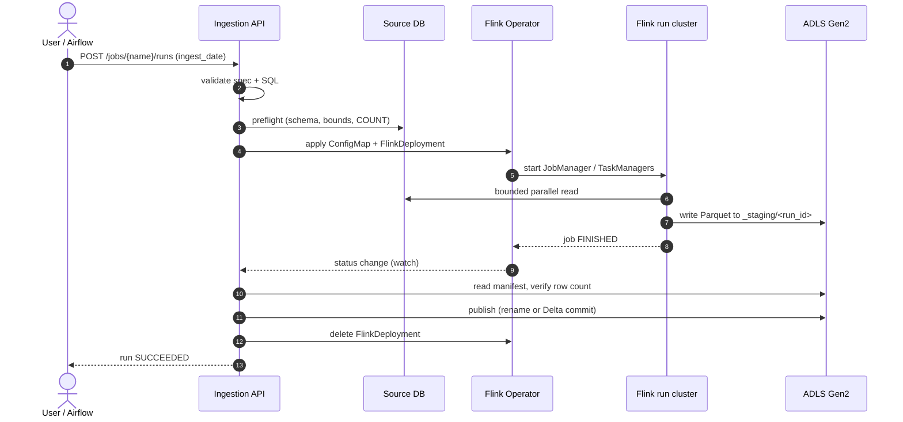

# Architecture

Status: **Draft (Phase 0)** · Last updated: 2026-10-21

This document describes the target architecture of the self-service ingestion platform. Decisions with meaningful trade-offs are recorded separately as [ADRs](adr/README.md); this document links to them instead of repeating the reasoning.

## 1. Context and goals

Data consumers (analysts, the data team, other DE teams) regularly need a copy of an operational table or query result in the data lake. Today each request becomes a hand-written pipeline. The platform replaces that with a declarative flow:

1. The DE team onboards a source once (a `Connection`).
2. A user writes a `SELECT` query against that connection and picks a destination.
3. The platform compiles the request into a bounded Apache Flink batch job, runs it, verifies the result, and publishes it to the lake.

The design is inspired by Grab's [one-click ingestion platform](https://engineering.grab.com/one-click-data-ingestion-platform-with-apache-flink), scoped down to batch snapshots for v1.

### Goals (v1)

- Sources: **SQL Server**, **PostgreSQL**, **BigQuery**.
- Destination: **Azure Data Lake Storage Gen2** (Blob Storage with hierarchical namespace).
- Formats: **Parquet** and **Delta Lake**, partitioned by `ingest_date`.
- Users can write **free-form read-only SQL** (joins, CTEs, aggregations).
- Every source type and sink type is described by a **versioned YAML template**; adding a new source of an existing type requires no code.
- A job **stops by itself** when the source data is exhausted, and a run is only marked successful after **row-count verification**.
- The whole flow works from **CLI / Git** before any UI exists.

### Non-goals (v1)

- Change data capture and streaming ingestion.
- Built-in scheduling (see [ADR-0006](adr/0006-scheduling.md)).
- Transformations beyond what the user's `SELECT` expresses.
- Sinks other than ADLS Gen2 (S3 and GCS are planned; the design keeps them pluggable).

## 2. Overview


The system has three planes:

| Plane | Responsibility | Runs on |
|---|---|---|
| **Control plane** | Templates, validation, rendering, submission, run tracking, verification, publishing | AKS (FastAPI service + Postgres) |
| **Execution plane** | One short-lived Flink application cluster per run | AKS via the Flink Kubernetes Operator |
| **Storage plane** | Sources (read-only) and the lake (ADLS Gen2) | Existing infrastructure |

The control plane never moves data. The execution plane never decides whether a run succeeded.

## 3. Components

### 3.1 Web UI (Phase 6)

React application with a SQL editor (Monaco), connection picker, data preview, schema view, sink options and run history. Forms are generated from the JSON Schema of each template, so a new template appears in the UI without frontend changes. The UI only produces `IngestionJob` YAML and calls the API; it holds no business logic.

### 3.2 Ingestion API

Python 3.12 / FastAPI. Modules:

| Module | Responsibility |
|---|---|
| **Template registry** | Loads `templates/**` from Git, keeps every version, exposes JSON Schemas |
| **Spec / SQL validator** | Validates YAML against JSON Schema; parses and checks user SQL with `sqlglot` ([ADR-0005](adr/0005-free-form-sql.md)) |
| **Preflight** | Runs preview, schema introspection, partition bounds and `COUNT(*)` against the source |
| **Renderer** | Jinja2: template + connection + job + preflight results → resolved job spec and `FlinkDeployment` manifest |
| **Submitter** | Creates the ConfigMap and `FlinkDeployment` through the Kubernetes API |
| **Run watcher** | Watches `FlinkDeployment` status, enforces timeouts, drives the run state machine |
| **Publisher** | Verifies row counts and atomically publishes staged output ([ADR-0004](adr/0004-lake-layout-and-delta-commit.md)) |

A CLI, `ingestctl`, wraps the same library code (`validate`, `render`, `submit`, `run`, `status`) so the DE team can work entirely from Git.

### 3.3 Metadata DB

PostgreSQL. Main tables:

| Table | Content |
|---|---|
| `templates` | Template name, version, body, JSON Schema |
| `connections` | Onboarded connections (secret references only, never secret values) |
| `jobs`, `job_versions` | Job specs; every edit creates a new immutable version |
| `runs` | One row per execution: state, `ingest_date`, Flink job id, expected rows, written rows, output paths, error |
| `run_events` | Append-only state transitions and diagnostics |

### 3.4 Ingestion runner

A single generic Flink job (Java 17, Flink 1.20, Table API + DataStream API) shipped as one container image together with all connectors, JDBC drivers and the `flink-azure-fs-hadoop` plugin. It receives a resolved job spec, never a template, and:

1. Substitutes secrets from environment variables.
2. Builds the source in **table mode** (Flink JDBC table connector, filter push-down, partitioned scan) or **query mode** (`JdbcSource` with arbitrary SQL), or the BigQuery source.
3. Adds audit columns `ingest_date`, `_ingest_run_id`, `_ingested_at`.
4. Writes Parquet into the run's staging location.
5. Writes `_manifest.json` (row count, file list, schema) next to the output.

### 3.5 Flink Kubernetes Operator

Each run is one `FlinkDeployment` in application mode with `upgradeMode: stateless` and `execution.runtime-mode: BATCH`. One cluster per run gives resource isolation and a small blast radius; the start-up cost (tens of seconds) is acceptable for batch. See [ADR-0001](adr/0001-flink-on-kubernetes-operator.md).

### 3.6 Secrets and identity

- Connections store references such as `kv://kv-dataplatform/crm-sqlserver-ro`, never values.
- Runner pods receive source credentials as environment variables through the Azure Key Vault CSI driver.
- Access to ADLS Gen2 and Key Vault uses Azure Workload Identity bound to the `flink-ingestion` service account.
- Every source connection uses a dedicated **read-only** database principal. This is the primary security control; SQL validation is a second layer.

### 3.7 Observability

- Flink metrics through the Prometheus reporter; Grafana dashboards per run and per connection.
- Flink History Server keeps job details after the cluster is deleted.
- Run state, counts and errors live in the Metadata DB and are exposed by the API.

## 4. Run lifecycle



### Run states

```
DRAFT → VALIDATED → SUBMITTED → RUNNING → VERIFYING → PUBLISHING → SUCCEEDED
                         └──────────┴───────────┴────────────┴──→ FAILED | TIMED_OUT | CANCELLED
```

- At most one active run per `(job, ingest_date)`. A new request for the same pair is rejected while one is active.
- Re-running a finished `(job, ingest_date)` replaces that partition (idempotent).
- Retries re-run the whole run; partial output only ever exists in staging.

## 5. Bounded execution and completion detection

Details and alternatives: [ADR-0002](adr/0002-bounded-batch-execution.md).

| Layer | Mechanism |
|---|---|
| **L1 Bounded by design** | `execution.runtime-mode: BATCH` with bounded sources only. The set of splits is fixed at start; when every split is read the job reaches `FINISHED`. Nothing polls the source for "more data". |
| **L2 Fixed cut-off** | Preflight captures `run_ts` and partition bounds (`MIN/MAX`) and passes them as constants, so rows inserted during the run cannot extend it. Optional `snapshot_column` adds `<= run_ts`. SQL Server reads from a readable secondary with `applicationIntent=ReadOnly`; BigQuery queries are materialized into a temp table first. |
| **L3 Detection** | The run watcher uses a Kubernetes informer on `FlinkDeployment.status.jobStatus.state` with the Flink REST API as fallback. A hard timeout per run (default `2h`) cancels the run and marks it `TIMED_OUT`. |
| **L4 Verification** | Expected rows come from preflight `COUNT(*)`; written rows come from the runner manifest and are cross-checked against Parquet footers. Policy per job: `exact`, `tolerance` (percentage), or `skip`. A mismatch fails the run and keeps staging for debugging. |

## 6. Configuration model

Four YAML kinds, each owned by a different role. Full field reference: [configuration-spec.md](configuration-spec.md).

| Kind | Owner | Purpose |
|---|---|---|
| `SourceTemplate` | Platform team | Describes a source type: connector, parameters, defaults, type mapping, preflight SQL per dialect |
| `SinkTemplate` | Platform team | Describes a destination type: format, URI pattern, layout, write options |
| `Connection` | DE team | One onboarded source instance plus load limits |
| `IngestionJob` | Users / data team | Connection + query + sink + verification + runtime settings |

The renderer combines them into a **resolved job spec** and a **`FlinkDeployment` manifest**. Both are stored per run for audit and replay. Why not Flink CDC pipeline YAML: [ADR-0003](adr/0003-own-yaml-model.md).

## 7. Query handling

Users write free-form read-only SQL in the source's own dialect ([ADR-0005](adr/0005-free-form-sql.md)).

1. **Parse** with `sqlglot` using the template's dialect (`tsql`, `postgres`, `bigquery`).
2. **Reject** anything that is not exactly one read-only query: multiple statements, DML/DDL, `SELECT ... INTO`, procedure calls, and dialect-specific escape hatches (`OPENROWSET`, `OPENQUERY`, `dblink`, `pg_sleep`, ...).
3. **Require** unique, named output columns.
4. **Choose the mode:**
   - *Table mode*: a single table with projection and filter. Uses the Flink JDBC table connector, which supports filter push-down and partitioned scans.
   - *Query mode*: everything else. Uses `JdbcSource` with the user's SQL.
5. **Rewrite through the AST, never by string concatenation**, to build preview, count, bounds and partitioned variants. For T-SQL, CTEs are hoisted because `SELECT * FROM (WITH ...)` is invalid, and top-level `ORDER BY` is removed.
6. **Partitioning** is optional. With a numeric or date `partition_column` from the output, the query is split into `BETWEEN ? AND ?` ranges; without one the source runs with parallelism 1.
7. **BigQuery**: the query is dry-run first (bytes estimate, schema). The run materializes it into `temp_dataset.ingest_<run_id>` with a 24h expiration and reads that table through the Storage Read API.

Preflight on complex queries executes them more than once (count and bounds). Jobs can set `verify.row_count: skip` and leave `partition_column` empty to avoid that cost.

## 8. Destinations and lake layout

Details and alternatives: [ADR-0004](adr/0004-lake-layout-and-delta-commit.md).

```
abfss://raw@<account>.dfs.core.windows.net/
  parquet/<system>/<schema>/<table>/ingest_date=YYYY-MM-DD/part-*.parquet
                                   /ingest_date=YYYY-MM-DD/_SUCCESS
  delta/<system>/<schema>/<table>/_delta_log/
                                 /ingest_date=YYYY-MM-DD/part-*.parquet
  _staging/<run_id>/...
```

- **Partitioning**: every table is partitioned by `ingest_date`, so the lake keeps one snapshot per ingest day. A re-run for the same `ingest_date` replaces only that partition.
- **Parquet**: the runner writes to staging. The publisher replaces the target `ingest_date=` directory with a directory rename (atomic on ADLS Gen2 with hierarchical namespace), then writes `_SUCCESS` and `_manifest.json`.
- **Delta** (preferred option, confirmed in the Phase 1 spike): the runner writes Parquet files under the table root in a run-specific directory. The publisher then makes a **single Delta commit** that adds the new files and removes the previous files of that `ingest_date`. Files are invisible to readers until that commit. The fallback is the `delta-flink` sink with append plus a cleanup delete.
- **Audit columns** on every row: `ingest_date`, `_ingest_run_id`, `_ingested_at`.
- The storage account **must** have hierarchical namespace enabled. Data (`raw`) and Flink system files (`flink`: HA metadata, history archive) live in separate containers.

Adding S3 or GCS later means adding a sink template (URI scheme plus filesystem plugin) and a publisher strategy; the runner stays unchanged.

## 9. Triggering and scheduling

Details: [ADR-0006](adr/0006-scheduling.md).

- **Phases 1–4**: runs are triggered on demand by `ingestctl run <job>` or `POST /jobs/{name}/runs`. Both accept `ingest_date` (default: today in `Asia/Ho_Chi_Minh`), which also enables backfills.
- **Interim** (if needed before Phase 5): a Kubernetes `CronJob` that calls `ingestctl run <job> --wait`.
- **Phase 5**: Airflow integration. An `IngestionRunOperator` triggers a run through the API and waits on its state as a deferrable task. `ingest_date` maps to the DAG run's logical date. DAGs are generated from the optional `schedule` field of `IngestionJob`, or written by hand when ingestion is part of a larger DAG.
- The control plane remains the single source of truth for run state; Airflow only triggers and observes.

## 10. Deployment topology

| Environment | Execution | Storage | Purpose |
|---|---|---|---|
| **local** | docker-compose: Flink 1.20 session cluster, SQL Server 2022, PostgreSQL 16 | Dev ADLS Gen2 account (Azurite does not fully support `abfss://` with hierarchical namespace) | Phases 1–3 |
| **dev** | AKS + Flink Kubernetes Operator | Dev ADLS Gen2 account | Phase 4 onwards |
| **prod** | AKS + Flink Kubernetes Operator | Prod ADLS Gen2 account | After Phase 4 sign-off |

Submission differs by environment only in the Submitter backend: Flink REST (session cluster) locally, Kubernetes API (FlinkDeployment) on AKS.

## 11. Technology stack

| Concern | Choice |
|---|---|
| Engine | Apache Flink 1.20 |
| Connectors | `flink-connector-jdbc` 3.3.x (`-1.20`), Google `flink-bigquery-connector`, Flink filesystem connector + Parquet format, `flink-azure-fs-hadoop` |
| Orchestration | Flink Kubernetes Operator on AKS |
| Runner | Java 17, Maven |
| Control plane | Python 3.12, FastAPI, Pydantic v2, Jinja2, sqlglot, kubernetes client, delta-rs, pyarrow |
| Metadata | PostgreSQL 16 |
| UI | React, Monaco editor |
| Secrets / identity | Azure Key Vault + CSI driver, Azure Workload Identity, Entra ID SSO |
| Observability | Prometheus, Grafana, Flink History Server |
| Scheduling (Phase 5) | Apache Airflow |

Exact connector versions are pinned at the end of the Phase 1 spikes.

## 12. Repository layout (target)

```
templates/
  sources/          sqlserver.yaml  postgresql.yaml  bigquery.yaml
  sinks/            adls_parquet.yaml  adls_delta.yaml
  runtime/          flinkdeployment.yaml.j2
  schemas/          JSON Schemas for every kind
connections/        onboarded connections (PR-reviewed)
jobs/               Git-managed ingestion jobs
control-plane/      FastAPI service, ingestctl CLI, tests
runner/             Flink job (Java) and its Dockerfile
ui/                 Web UI
deploy/             docker-compose, Helm charts
docs/               architecture, roadmap, spec, ADRs
```

Directories are created in the phase that first needs them (see [roadmap.md](roadmap.md)).

## 13. Risks

| Risk | Impact | Mitigation |
|---|---|---|
| Delta commit strategy does not work as designed on ADLS Gen2 | No Delta output | Phase 1 spike; fallback to `delta-flink` sink |
| `flink-bigquery-connector` has no Flink 1.20 build | No BigQuery source | Phase 1 spike; fallback to `EXPORT DATA` to GCS and read files |
| Full reads overload OLTP databases | Production impact | Read replicas, per-connection concurrency and partition limits, optional run windows |
| Inconsistent snapshot with parallel reads | Missing or duplicated rows | Fixed bounds, `run_ts`, snapshot isolation, tolerance policy |
| Heavy or unsafe user SQL | Source load, BigQuery cost | Read-only principals, AST validation, `statement_timeout`, BigQuery dry-run byte limit |
| Unsupported column types | Mid-run failures | Type mapping in templates; preflight rejects unsupported types and suggests a `CAST` |
| Many small files | Slow downstream reads | Parallelism derived from row estimates, target file size, Delta compaction |
