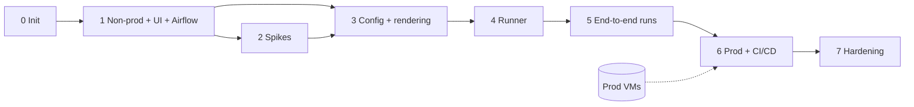

# Roadmap

Last updated: 2026-11-01 · Current phase: **Phase 2: Connector spikes**

> **Where we left off (2026-10-26).** Phase 1 closed (`v0.1.0`). Phase 2 groundwork is on `main` but nothing has run in Docker yet: Flink image (builds in CI), PostgreSQL and MySQL test sources, spike jobs in `code/spikes/phase-2/`, results template in [spikes/phase-2.md](spikes/phase-2.md). CI runs on every push (green); the Deploy workflow is ready but off until the VMs exist ([ADR-0012](adr/0012-cicd-ssh-deploy.md)).
>
> **Next, in order:**
> 1. In a Codespace: `git pull`, `bash infrastructure/non-prod/bootstrap.sh` (writes `example-sources/<source>/.env`, `sources.env` and the `ingestion-sources` network), `docker compose -f infrastructure/non-prod/docker-compose.yml up -d --build`, then `docker compose -f infrastructure/non-prod/example-sources/docker-compose.yml up -d`; every service healthy in both projects.
> 2. Phase 1 carry-over checks (since 5e: create the connection and jobs by hand, merge the pull requests, then Airflow), as the demo in [example-sources/README.md](../infrastructure/non-prod/example-sources/README.md): connection + job in the UI, pull request merged, DAG appears, triggered in Airflow → WordCount `FINISHED`, broken file flagged.
> 3. JDBC spikes (`code/spikes/phase-2/README.md`): table mode on all three sources, `check_parquet.py`, query mode, REST submission with `PythonDriver`; then `seed-large.sh` and the 10M-row throughput runs. Fill [spikes/phase-2.md](spikes/phase-2.md) as you go.
> 4. Needed from the user, as Codespaces secrets: ADLS Gen2 dev account (hierarchical namespace on, container `data-onboarding-ingestion`) + service principal (spike 8), BigQuery test project + service account JSON (spike 9). The user also plans their own PostgreSQL and MySQL test databases: onboard them in the UI with the new templates.
> 4b. Done early (2026-10-26, from Phase 3): source templates `postgresql@1` and `mysql@1`, with Test connection and preview in the API (psycopg, PyMySQL) and sample connections to the non-prod test sources. Verify both in the Codespace with step 1.
> 5. After that: Delta commit spike, Parquet timestamps in Spark.
> 5b. Done early (2026-10-30): REST API source decided in [ADR-0015](adr/0015-rest-api-source-via-redpanda.md) (Airflow `fetch` → Redpanda → Flink reads the run's offsets). Template `rest_api@1`, `fetch` task, Redpanda and a test API (`api-source`) in non-prod, sample job `shop-api-orders-daily`. Checked outside the Codespace (2026-10-30): `airflow dags test ingest__shop-api-orders-daily` on Airflow 3.3.2 ran `validate → fetch → submit → wait` against a real Redpanda v25.3.18 and the test API (a 429 retried, offsets [200, 300) handed to `submit`, no token in the logs); Flink 1.20.3 with the Kafka connector read offsets [100, 200) to Parquet and stopped by itself (`FINISHED`, exactly 100 rows). Still to run in the Codespace: `docker compose up --build` with the new Airflow image, "Run now" on `ingest__shop-api-orders-daily`, then spike 12 (`kafka_to_parquet.py` from PyFlink).
> 5c. 2026-10-30: **test sources moved out of the platform.** SQL Server, PostgreSQL, MySQL and the test API live in `infrastructure/non-prod/example-sources/`, each with its own Compose file and `.env` (start one alone, or all through the parent file), started by hand for a demo. `pipelines/` starts empty, as in a new prod; the former sample files are examples in `example-sources/examples/` (validated by CI, plus a PostgreSQL and a MySQL job). Source secrets reach the platform through `infrastructure/non-prod/sources.env`, the twin of prod's `vm1/sources.env`. Checked: every Compose file and `bootstrap.sh` (first run and rerun), SQL Server and its seed started alone and then through the parent file (same containers), the read-only login from another container on `ingestion-sources`. Not checked here (Docker Hub rate limit): PostgreSQL, MySQL and the test API containers, and the platform stack with `sources.env`; run step 1 above.
> 5d. 2026-11-01: **Airflow moved to [data-onboarding-orchestration](https://github.com/thanhphat2609/data-onboarding-orchestration)** ([ADR-0016](adr/0016-airflow-moves-to-orchestration.md)). `code/airflow/`, the Airflow image and the `local-db` PostgreSQL left this repository; items below that name those paths now mean the same files there. Not run yet in Docker: needs a Codespace check of the two stacks together.
> 5e. 2026-11-01: **The Web UI opens pull requests on data-onboarding-orchestration** ([ADR-0017](adr/0017-ui-opens-pull-requests-on-orchestration.md)); this repository keeps what changes rarely: Web UI, API, templates and schemas, the PyFlink runner, Flink and Redpanda. Done in this repository: `airflow.py`, the `/runs` endpoints, "Run now", run dots and the pool call removed (the UI links to Airflow); new `github.py` (branch, commit, pull request through the GitHub REST API) and `SAVE_MODE=pull_request` (non-prod default, needs the Codespaces user secret `ORCHESTRATION_GITHUB_TOKEN`; `disk` keeps files local); `pipelines/` is a git-ignored working copy and the repository has no example connections or jobs (the demo creates them by hand); the three test databases now hold `segments` (3), `customers` (10,000) and `orders` (5,000) for several jobs on one connection; CI no longer validates `pipelines/`. Tested offline against a fake GitHub (`tests/test_pull_request_flow.py`); not run against real GitHub or Docker yet.
>    **Prototype week, in order:** (a) create the token and the Codespaces secret; (b) in data-onboarding-orchestration: its own `pipelines/jobs/` and `pipelines/connections/` (with a `.gitkeep`), Compose files and DAG factory reading them there instead of the ingestion checkout, a CI check that validates them with the schemas from here; (c) happy path in a Codespace: start the example sources, create a connection and two jobs on it in the Web UI, merge the pull requests, see two DAGs in Airflow; (d) then Phase 4's runner and a `spec_version` in the resolved spec. Open: the job wizard lists only the working copy, so after a Codespace rebuild merged connections are not offered (point `INGESTION_PIPELINES_DIR` at an orchestration checkout, or read them through the GitHub API); `fetch` still imports `ingestion.rest_api` from this checkout; prod keeps the old `pipelines/`-only sync until Phase 6.
> 5f. 2026-11-01: **Configuration only through GitHub** (both repositories). New secret `ORCHESTRATION_GITHUB_TOKEN`: a Codespaces user secret in non-prod (declared in both `devcontainer.json` files, so Codespaces asks for it), an Actions secret in prod (required: the prod Deploy stops without it; written to the API's environment like every setting, ADR-0013). Optional variables `ORCHESTRATION_REPOSITORY`, `ORCHESTRATION_BASE_BRANCH`. `AIRFLOW_ADMIN_PASSWORD` left this repository. The `pipelines/`-only sync moved to the orchestration repository's Deploy workflow (`deploy.sh --pipelines-only`); here the Deploy workflow is manual only. The full list of names: [infrastructure/README.md](../infrastructure/README.md#github-secrets-and-variables) and [prod/README.md](../infrastructure/prod/README.md). Not run in GitHub yet (the VMs don't exist).
> 6. When the prod VMs exist: [infrastructure/prod/README.md](../infrastructure/prod/README.md) (VM setup, GitHub secrets, `PROD_DEPLOY_ENABLED=true`), deploying data-onboarding-agent first.

Each phase has a single goal, a checklist, concrete deliverables, and exit criteria. A phase is closed only when every exit criterion is met; open items move explicitly to a later phase instead of being dropped. Estimates assume one to two data engineers.

| Phase | Goal | Estimate | Status |
|---|---|---|---|
| [0](#phase-0-project-initialization) | Project initialization: architecture, plan, decisions | 1 week | Open items: review, access |
| [1](#phase-1-non-prod-environment-web-ui-and-airflow) | Non-prod environment, Web UI and Airflow (SQL Server) | 2–3 weeks | Done 2026-10-25 (`v0.1.0`), checks carried over to Phase 2 |
| [2](#phase-2-connector-spikes) | Connector spikes: SQL Server, PostgreSQL, MySQL, BigQuery; then a REST API source | 1–2 weeks | **In progress** |
| [3](#phase-3-configuration-model-and-rendering) | Configuration model, validation, rendering, CLI | 1–2 weeks | Not started |
| [4](#phase-4-ingestion-runner) | Generic Flink ingestion runner | 2 weeks | Not started |
| [5](#phase-5-end-to-end-runs-through-airflow) | End-to-end runs through Airflow | 2 weeks | Not started |
| [6](#phase-6-prod-environment-and-cicd) | Prod environment and CI/CD | 1–2 weeks | CI live; deploy pipeline and prod Compose drafted ([ADR-0012](adr/0012-cicd-ssh-deploy.md)); blocked on the prod VMs |
| [7](#phase-7-hardening-and-extensions) | Hardening and extensions | Ongoing | Not started |

Phase 2 can start as soon as the Phase 1 Flink cluster runs in non-prod. Phase 6 needs Phase 5 and the prod VMs.

### Releases

Tags follow [CONTRIBUTING.md](../CONTRIBUTING.md#versioning-and-releases): `v0.<phase>.0-rc.<n>` for testing, `v0.<phase>.0` when a phase's exit criteria are met.

| Tag | Date | Content |
|---|---|---|
| `v0.1.0-rc.1` | 2026-10-22 | Phase 1 first cut: Web UI on the mock API, non-prod Compose, DAG factory, templates and schemas |
| `v0.1.0-rc.2` | 2026-10-25 | Shared metadata DB with the agent stack ([ADR-0011](adr/0011-shared-postgresql-server.md)) |
| `v0.1.0-rc.3` | 2026-10-25 | Ingestion API (`code/control-plane/`); the Web UI container uses it instead of the mock |
| `v0.1.0` | 2026-10-25 | Phase 1 closed: non-prod stack runs in Codespaces (Compose fix for the `flink-examples` volume) |
| `v0.2.0-rc.1` | 2026-10-30 | Phase 2 groundwork: Flink image, PostgreSQL and MySQL sources and spikes, REST API source through a Redpanda landing topic ([ADR-0015](adr/0015-rest-api-source-via-redpanda.md)), CI checks and Deploy workflow ([ADR-0012](adr/0012-cicd-ssh-deploy.md), [ADR-0013](adr/0013-prod-settings-in-github.md), [ADR-0014](adr/0014-prod-save-flow.md)) |

---

## Phase 0: Project initialization

**Goal:** agree on what is being built and how, before writing code.

### Checklist

- [x] Architecture document ([architecture.md](architecture.md)) with diagram
- [x] Roadmap with phases and exit criteria (this document)
- [x] Configuration spec draft for all four YAML kinds ([configuration-spec.md](configuration-spec.md))
- [x] ADRs for key decisions ([adr/](adr/README.md))
- [x] Repository conventions: English-only content, `.gitignore`, `.editorconfig`, [CONTRIBUTING.md](../CONTRIBUTING.md)
- [x] Re-plan: Flink on VMs instead of AKS, UI and Airflow first, non-prod on Codespaces ([ADR-0007](adr/0007-flink-standalone-session-cluster.md), [ADR-0008](adr/0008-airflow-dag-per-job.md), [ADR-0009](adr/0009-environments.md))
- [ ] Answer the [open questions](#open-questions) or assign an owner and a due date to each
- [ ] Review architecture, spec and ADRs; move accepted ADRs from `Proposed` to `Accepted`
- [ ] Request access needed for Phase 2: dev ADLS Gen2 account, a test PostgreSQL database, a BigQuery test project and service account

### Deliverables

`docs/architecture.md`, `docs/roadmap.md`, `docs/configuration-spec.md`, `docs/adr/*`, `CONTRIBUTING.md`, updated `README.md`.

### Exit criteria

- Architecture, spec and ADRs are reviewed and merged to `main`.
- Every open question is answered or has an owner and a due date.
- Phase 2 access (storage account, test databases, BigQuery project) is granted or requested with an ETA.

---

## Phase 1: Non-prod environment, Web UI and Airflow

**Goal:** a data engineer opens a Codespace, onboards a SQL Server connection and creates a job in the Web UI, and the job appears in Airflow as its own DAG that can submit work to the Flink JobManager.

Scope is **SQL Server only**. PostgreSQL, MySQL and BigQuery forms follow in Phase 3.

**Closed on 2026-10-25** by decision: the stack starts in a Codespace and the Web UI works on the real API. The end-to-end checks below were not all run yet; they are the first item of Phase 2, and items marked *verify* stay open until then.

### Checklist

**Infrastructure ([ADR-0009](adr/0009-environments.md))**

- [ ] `infrastructure/non-prod/docker-compose.yml`: Web UI, Ingestion API, Airflow 3 (standalone, one container), PostgreSQL 16 (Airflow metadata and platform database), Flink 1.20 JobManager and TaskManager, SQL Server 2022 with a seeded sample database. *Written, including the API; Codespace verification in progress (2026-10-25: fixed the undeclared `flink-examples` volume)*
- [ ] Dockerfiles in `infrastructure/docker/`: `ui` and `api` written; Airflow and Flink use upstream images until they need extra dependencies
- [ ] `.devcontainer/devcontainer.json`: machine type (at least 4 cores / 16 GB), forwarded ports (Web UI, Ingestion API, Airflow, Flink web UI), Compose started on start. *Written; not yet verified in a Codespace*
- [ ] Shared volumes: `pipelines/connections/` and `pipelines/jobs/` between the API and Airflow; a run directory between Airflow and the JobManager. *Written; verify in a Codespace*
- [ ] Airflow folder layout per repository: `code/airflow/dags/` mounted at `dags/ingestion/`, config files at `projects/ingestion/` ([ADR-0008](adr/0008-airflow-dag-per-job.md))
- [x] Secrets from Codespaces secrets or `infrastructure/non-prod/.env` (never committed, generated by `bootstrap.sh`), referenced as `env://<VAR>`; `.env.example` committed
- [x] `infrastructure/README.md`: start, stop and reset non-prod
- [x] Pin Airflow and component versions (Airflow 3.3.2, Flink 1.20.5, PostgreSQL 16.15, SQL Server 2022 CU27, nginx 1.30.6)
- [ ] Shared metadata DB ([ADR-0011](adr/0011-shared-postgresql-server.md)): Airflow on the `data-platform` network, `local-db` profile for a standalone Codespace, `start.sh` waits for the DB. *Written; verify standalone in a Codespace, then shared mode with the agent stack on one host*

**Configuration (first cut)**

- [x] `code/templates/sources/sqlserver.yaml` and `code/templates/sinks/adls_parquet.yaml`
- [x] JSON Schemas in `code/templates/schemas/` for `Connection` and `IngestionJob`; template parameters are validated from the template itself

**Ingestion API (`code/control-plane/`)**

- [ ] FastAPI service; YAML files in `pipelines/connections/` and `pipelines/jobs/` are the store ([README](../code/control-plane/README.md)). *Written; tested against fakes; verify in a Codespace*
- [x] Endpoints: templates and schemas, connections, jobs, invalid files
- [ ] `POST /connections/{name}/test`: opens a connection with the given parameters and reports a clear error (pymssql; warns when the login can write). *Written; tested against fakes; verify in a Codespace*
- [x] SQL check with sqlglot: exactly one read-only statement, named and unique columns ([ADR-0005](adr/0005-free-form-sql.md), basic rules only)
- [ ] Preview: first 100 rows and column types of the user's query (`sys.dm_exec_describe_first_result_set`). *Written; tested against fakes; verify in a Codespace*
- [x] YAML writer: validates against the schema, writes `pipelines/jobs/<name>.yaml`, rejects a name that differs from the file name or that changes an existing job; atomic writes
- [x] ~~Airflow client: "Run now" (unpauses the DAG first) and the latest runs of a DAG through the Airflow REST API. *Written; tested against fakes; verify in a Codespace*~~ Removed 2026-11-01 (ADR-0017): the Web UI links to Airflow.
- [ ] Saving a connection creates or resizes its pool `conn__<name>` through the Airflow REST API. *Written; tested against fakes; verify in a Codespace*

**Web UI (`code/ui/`)**

- [x] React, Vite, TypeScript, shadcn/ui with a sidebar layout and dark mode; CodeMirror instead of Monaco to stay light
- [x] In-browser mock of the Ingestion API so the UI works before the API exists; the container uses the real API (`API_MODE=http`, nginx proxies `/api`), the dev server keeps the mock unless `VITE_API_MODE=http`
- [x] Connections page: list, "New connection" form generated from the template, "Test connection" (through the API)
- [x] New job wizard: Source (connection, SQL editor, validation, preview) → Sink → Schedule → Review (form and live YAML side by side) → Save, Export YAML (validation and preview through the API)
- [x] Job name suggested as `<system>-<dataset>-<frequency>`, locked after the job is created
- [x] Jobs page: latest runs, "Run now", links to the Airflow DAG and the Flink web UI; invalid files flagged (runs and invalid files from the API)

**Airflow (`code/airflow/`, [ADR-0008](adr/0008-airflow-dag-per-job.md))**

- [ ] `code/airflow/dags/ingestion_dag_factory.py`: one DAG `ingest__<name>` per job file, with schedule, owner, tags, `max_active_runs=1` and pool `conn__<connection>`. *Written and tested against a stub of the Airflow SDK; verify in a Codespace*
- [ ] Pools created from the connection files (`code/airflow/scripts/sync_pools.py`, run on Airflow start). *Verify in a Codespace*
- [ ] Invalid files skipped and logged with a one-line reason; other DAGs keep loading. *Tested against the stub*
- [ ] Skeleton tasks `validate → submit → wait`: submit Flink's WordCount example through the JobManager REST API and wait for `FINISHED` (replaced by the runner in Phase 4). *Tested against a fake Flink REST API*

**Carried over to Phase 2: verify in a Codespace** (closes the items marked *verify* above)

1. New Codespace: every service healthy (`docker compose ps`), Web UI without the "Mock API" badge.
2. Create a SQL Server connection to `sqlserver` / `crm` with `env://CRM_SQLSERVER_RO_PASSWORD`; "Test connection" passes; pool `conn__<name>` appears in Airflow.
3. Create a job: SQL validation and preview show real rows; the saved file appears in `pipelines/jobs/`.
4. DAG `ingest__<name>` appears in Airflow in under a minute.
5. "Run now" in the UI: the run shows in the Jobs page, WordCount reaches `FINISHED` in the Flink web UI.
6. A broken file in `pipelines/jobs/` is flagged in the UI and other DAGs still load.
7. Usability test with two data team members.

### Deliverables

`infrastructure/`, `.devcontainer/`, `code/control-plane/` (API), `code/ui/`, `code/airflow/`, first templates and schemas.

### Exit criteria

- A new Codespace starts every service healthy with no manual step besides setting secrets.
- A data engineer creates a SQL Server connection (test passes) and a job in the UI; the saved YAML validates against the schema.
- The DAG `ingest__<name>` appears in Airflow within one DAG-processor parse cycle (target: under one minute) after saving, without a restart.
- "Run now" in the UI triggers the DAG, and the smoke Flink job reaches `FINISHED` on the TaskManager.
- A broken job file does not stop other DAGs from loading and is flagged in the UI.
- Usability test: two data team members each create a connection and a job in under five minutes.

---

## Phase 2: Connector spikes

**Goal:** prove every risky building block works on Flink 1.20 before designing code around it.

Sources, in order: **SQL Server, PostgreSQL, MySQL, BigQuery**. A REST API source comes after those four work.

### Checklist

- [ ] Phase 1 carry-over: run the [Phase 1 checks](#phase-1-non-prod-environment-web-ui-and-airflow) (Run now → `FINISHED`, invalid file flagged, usability test) and ADR-0011 shared mode
- [ ] Flink image (`infrastructure/docker/flink/`) with `flink-azure-fs-hadoop`, JDBC connector and drivers; write to the dev ADLS Gen2 account with `abfss://`. *Image written; build and ADLS write to verify (ADLS needs credentials)*
- [ ] Add PostgreSQL 16 and MySQL 8.4 test sources with seeded sample tables (small and ~10M rows) to non-prod; add a ~10M-row table to the SQL Server seed. *Written: `postgres-source`, `mysql-source`, `seed-large.sh`; verify in a Codespace*
- [ ] Spike: PostgreSQL → Parquet with partitioned scan (`scan.partition.*`, `scan.auto-commit=false`)
- [ ] Spike: SQL Server → Parquet, including `applicationIntent=ReadOnly`
- [ ] Spike: MySQL → Parquet with partitioned scan, streaming result sets (`useCursorFetch=true`) and a read-only user
- [ ] Spike ([ADR-0010](adr/0010-pyflink-runner.md)): PyFlink job submitted through REST with `PythonDriver` on the session cluster; JobManager image with Python and PyFlink, size measured
- [ ] Spike: query mode from PyFlink SQL: the JDBC table connector with a derived table `(<query>) AS q`, including a JOIN, an inlined CTE and a partitioned scan, on SQL Server, PostgreSQL and MySQL; fallback: Java `JdbcSource` through the PyFlink gateway
- [ ] Spike: BigQuery source on Flink 1.20 from PyFlink SQL DDL (table read and materialized query)
- [ ] Spike: Delta commit of externally written Parquet files with delta-rs, including replacing one `ingest_date` partition atomically; compare with the `delta-flink` sink
- [ ] Spike: Parquet timestamp encoding written by Flink is readable by Spark, pandas and Delta readers
- [ ] Measure throughput (rows/s per slot) per source for sizing defaults and the TaskManager slot count
- [ ] Pin connector and library versions; record results in [`docs/spikes/phase-2.md`](spikes/phase-2.md) (spike jobs in `code/spikes/phase-2/`)
- [x] After the four sources: spike a REST API source (paginated JSON over HTTP → Parquet). Flink has no generic HTTP source, so compare a PyFlink-side fetch, a custom source and an Airflow-side fetch; record the choice in an ADR. *Decided in [ADR-0015](adr/0015-rest-api-source-via-redpanda.md) (2026-10-30): Airflow `fetch` → Redpanda → bounded Flink read*
- [ ] Verify ADR-0015 in a Codespace: Airflow image with `confluent-kafka`, "Run now" on `ingest__shop-api-orders-daily` (`fetch` logs the offsets), `kafka_to_parquet.py` from PyFlink on those offsets

### Deliverables

Flink image, `docs/spikes/phase-2.md`, updated [ADR-0004](adr/0004-lake-layout-and-delta-commit.md) status, pinned version table in [architecture.md](architecture.md#11-technology-stack).

### Exit criteria

- SQL Server, PostgreSQL, MySQL and BigQuery run as batch jobs on the non-prod session cluster and reach `FINISHED` on their own.
- The REST API source approach is decided in an ADR (its implementation can move to a later phase).
- Output is readable by pandas and Spark.
- The Delta strategy and the BigQuery connector choice are decided and recorded.

---

## Phase 3: Configuration model and rendering

**Goal:** turn YAML into a correct, reviewable Flink job definition without running anything.

### Checklist

- [ ] JSON Schemas for all four kinds and all templates: `sqlserver`, `postgresql`, `mysql`, `bigquery`, `adls_parquet`, `adls_delta`. *`postgresql` and `mysql` templates added 2026-10-26, with Test connection and preview*
- [ ] Pydantic models generated from or checked against the schemas
- [ ] Full SQL validator (sqlglot): read-only check, dialect blocklist, unique named columns, table vs query mode
- [ ] AST-based rewrites: preview, count, bounds, partitioned query (CTE inlining into derived tables, `ORDER BY` removal)
- [ ] Preflight against live sources: schema introspection, type mapping, bounds, `COUNT(*)`, BigQuery dry-run
- [ ] Renderer: resolved job spec + Flink submission request
- [ ] `ingestctl validate | preflight | render`
- [ ] Golden tests: `tests/golden/<case>/{job.yaml, expected/}` for each source and both sinks
- [ ] CI: lint, unit tests, validation of every file in `pipelines/connections/` and `pipelines/jobs/`, including file name = `name`. *Lint, types, builds and file validation run in `.github/workflows/ci.yml` since 2026-10-26; unit tests to add*
- [ ] UI: PostgreSQL, MySQL and BigQuery connection forms (PostgreSQL and MySQL done 2026-10-26: forms come from the templates); preflight results (schema, row and byte estimates) in the job wizard
- [ ] Table browser: `GET /connections/{name}/tables` lists schemas, tables and estimated row counts (SQL Server: `INFORMATION_SCHEMA` + `sys.partitions`); in the Source step, picking a table writes `SELECT <columns> FROM <table>`
- [ ] Sink path suggested as `<system>/<schema>/<table>` from the connection and the query, like the job name; still editable

### Deliverables

`code/templates/**`, `code/control-plane/` library and CLI, `pipelines/connections/` and `pipelines/jobs/` examples, CI workflow (tests only; no deployment).

### Exit criteria

- `ingestctl render pipelines/jobs/<example>.yaml` produces the expected output for all four sources and both sinks.
- Every rejected SQL case in the test suite is rejected with an actionable message.
- CI blocks an invalid connection or job file.

---

## Phase 4: Ingestion runner

**Goal:** one generic Flink job that executes any resolved job spec.

### Checklist

- [ ] `code/runner/` Python package (PyFlink 1.20, Python 3.11), Table API and SQL only
- [ ] Spec loader and secret resolution (`env://`, later `kv://`) when the job graph is built
- [ ] Table mode and query mode (JDBC connector over a table or a derived table), BigQuery source
- [ ] Audit columns `ingest_date`, `_ingest_run_id`, `_ingested_at`
- [ ] Parquet writer to staging (filesystem connector); written rows counted from Parquet footers by the publisher
- [ ] Prometheus metrics reporter
- [ ] JobManager image with Python, PyFlink and the runner; connectors and drivers in the Flink image; TaskManager image unchanged
- [ ] `ingestctl submit` against the non-prod session cluster (Flink REST)
- [ ] Integration tests against the non-prod sources

### Deliverables

`code/runner/`, JobManager and TaskManager images, integration test suite.

### Exit criteria

- 3 sources × 2 formats run end to end from the CLI on non-prod.
- Manifest row counts equal source counts on seeded data.
- A killed TaskManager makes the job fail cleanly; nothing is visible outside staging.

---

## Phase 5: End-to-end runs through Airflow

**Goal:** every run, scheduled or on demand, goes through its DAG from preflight to publish and is verified ([ADR-0008](adr/0008-airflow-dag-per-job.md)).

### Checklist

- [ ] DAG tasks: preflight → render → submit → wait → verify → publish, using the `code/control-plane/` library
- [ ] `wait` as a deferrable task polling the Flink REST API; `runtime.timeout` cancels the Flink job
- [ ] A retry restarts the whole run, never a step in the middle
- [ ] `ingest_date` from the logical date, override through `conf`; backfill through Airflow
- [ ] Admission control: pool per connection and a pool for Flink task slots
- [ ] Publisher: verification policies, Parquet rename + `_SUCCESS`, Delta commit, staging cleanup
- [ ] `publish` emits an Airflow Asset for the table root URI; a sample downstream DAG schedules on it
- [ ] Platform `runs` and `run_events` tables with migrations; run history in the UI (state, counts, duration, errors, links)
- [ ] `ingestctl run <job> --wait` through Airflow
- [ ] Alerting on failed runs
- [ ] Grafana dashboard and Flink History Server

### Deliverables

Complete DAG factory and tasks, `runs` schema, UI run history, dashboards.

### Exit criteria

- A run goes through every step to success on non-prod.
- Injected failures (count mismatch, timeout, TaskManager kill, bad credentials) end in the correct terminal state with a clear error.
- Re-running the same `(job, ingest_date)` replaces the partition without duplicates.
- A backfill of seven `ingest_date` values produces seven partitions.

---

## Phase 6: Prod environment and CI/CD

**Goal:** the platform runs on the two prod VMs and changes reach them without manual steps. Starts when the prod VMs exist.

### Checklist

- [ ] `infrastructure/prod/vm1/docker-compose.yml` (Web UI, API, Airflow, Flink JobManager) and `infrastructure/prod/vm2/docker-compose.yml` (TaskManagers). *Drafted 2026-10-26; run on the VMs*
- [ ] Network: VM 2 → VM 1 JobManager RPC and blob server ports; fixed TaskManager port ranges; both VMs → sources and ADLS Gen2
- [ ] Prod secret backend (`kv://`) and ADLS Gen2 identity
- [ ] Platform and Airflow PostgreSQL in prod, with backups: the shared server of the agent stack on VM 1 ([ADR-0011](adr/0011-shared-postgresql-server.md)); `vm1` Compose joins `data-platform`; `pg_dump` per database
- [ ] CI/CD ([ADR-0012](adr/0012-cicd-ssh-deploy.md)): CI on every push and pull request; deploy over SSH when someone runs the Deploy workflow (the approval), only for a commit on `main` with green CI, building on each VM; `pipelines/`-only changes sync on their own. *Workflows written; merged branches are deleted by `delete-merged-branch.yml` (2026-10-27, same as data-onboarding-agent); every prod setting is a GitHub secret or variable and the Deploy workflow writes `.env` / `sources.env` on the VMs ([ADR-0013](adr/0013-prod-settings-in-github.md), 2026-10-27, checked locally with `render_env.py` + `docker compose config`); set the GitHub secrets and variables from [infrastructure/prod/README.md](../infrastructure/prod/README.md), then `PROD_DEPLOY_ENABLED=true`*
- [ ] **Job file sync:** every new or changed file in `pipelines/jobs/` and `pipelines/connections/` is fetched to VM 1 automatically (sync on merge to `main` or a periodic Git pull), so Airflow picks it up without a manual deployment. *Written: `pipelines/`-only changes sync to VM 1 without a rebuild*
- [ ] UI save in prod: a pull request per save, merged by the Data Team, synced to VM 1 by the `pipelines/`-only sync; a new `env://` reference adds a line to `vm1/sources.env.example` and a secret set by hand ([ADR-0014](adr/0014-prod-save-flow.md), proposed 2026-10-27). *To build: `SAVE_MODE=pull_request` in the API (branch + pull request through the GitHub API, token limited to Contents and Pull requests), UI message with the link and the secret to add*
- [ ] Entra ID SSO; roles: DE admin (onboard connections) and user (create jobs on granted connections)

### Exit criteria

- A scheduled job runs daily for one week on prod without manual intervention.
- A job file merged to `main` becomes a DAG on prod within the agreed sync interval, with no manual step.
- Restarting the TaskManager VM makes active runs fail and retry successfully.

---

## Phase 7: Hardening and extensions

Prioritized after Phase 6 based on demand:

- Incremental loads by watermark column
- Catalog registration (Unity Catalog or Hive Metastore) and post-publish data quality checks
- Sinks: S3, GCS; sources: Oracle, more REST APIs
- CDC with Flink CDC ([ADR-0003](adr/0003-own-yaml-model.md) revisit)
- JobManager high availability; more TaskManager VMs
- Delta compaction and retention of old `ingest_date` partitions
- Cost dashboards

---

## Open questions

| # | Question | Needed by | Owner | Answer |
|---|---|---|---|---|
| 1 | Do SQL Server and PostgreSQL sources have read-only replicas? If not, which run windows are allowed? | Phase 2 | | |
| 2 | Prod VMs: provider (Azure?), sizes, ETA, network access to sources and ADLS Gen2 | Phase 6 | | |
| 3 | Prod secret backend: Azure Key Vault with VM managed identity, or another store? | Phase 6 | | |
| 4 | Largest expected table (rows / GB)? Drives TaskManager size, slot count and timeouts. | Phase 2 | | |
| 5 | Target catalog: Unity Catalog, Hive Metastore, or path-only for v1? | Phase 7 | | |
| 6 | Retention for `ingest_date` partitions (keep all, or N days)? | Phase 5 | | |
| 7 | In prod, does the UI open a pull request for each job, or write directly and commit? | Phase 6 | | Proposed: a pull request per save; new source passwords as GitHub secrets by hand until Key Vault ([ADR-0014](adr/0014-prod-save-flow.md), 2026-10-27) |

### Resolved

| Question | Decision | Date |
|---|---|---|
| Delta: full overwrite or history? | Keep history, partitioned by `ingest_date`; re-run replaces the day | 2026-10-21 |
| Can users write free-form SQL? | Yes, read-only, including the data team ([ADR-0005](adr/0005-free-form-sql.md)) | 2026-10-21 |
| Runner language? | PyFlink, Table API and SQL only, so future maintainers only need Python ([ADR-0010](adr/0010-pyflink-runner.md)) | 2026-10-22 |
| Where does Flink run? | Standalone session cluster: JobManager with Airflow on VM 1, TaskManagers on VM 2; no Kubernetes ([ADR-0007](adr/0007-flink-standalone-session-cluster.md)) | 2026-10-22 |
| How are runs scheduled and triggered? | Airflow from Phase 1, one DAG `ingest__<name>` per job file; on-demand runs also go through Airflow ([ADR-0008](adr/0008-airflow-dag-per-job.md)) | 2026-10-22 |
| Is there an existing Airflow to integrate with? | No; the platform runs its own Airflow on VM 1 | 2026-10-22 |
| Which environments? | Non-prod on GitHub Codespaces (one Compose project), prod on two VMs; no prod CI/CD until the VMs exist ([ADR-0009](adr/0009-environments.md)) | 2026-10-22 |
| What comes first? | Web UI + Airflow + Flink JobManager (Phase 1), then spikes | 2026-10-22 |
