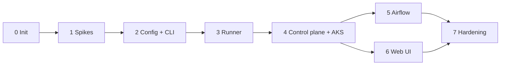

# Roadmap

Last updated: 2026-10-21 · Current phase: **Phase 0: Project initialization**

Each phase has a single goal, a checklist, concrete deliverables, and exit criteria. A phase is closed only when every exit criterion is met; open items move explicitly to a later phase instead of being dropped. Estimates assume one to two data engineers.

| Phase | Goal | Estimate | Status |
|---|---|---|---|
| [0](#phase-0-project-initialization) | Project initialization: architecture, plan, decisions | 1 week | **In progress** |
| [1](#phase-1-local-environment-and-connector-spikes) | Local environment and connector spikes | 1 week | Not started |
| [2](#phase-2-configuration-model-and-cli) | Configuration model, validation, rendering, CLI | 1–2 weeks | Not started |
| [3](#phase-3-ingestion-runner) | Generic Flink ingestion runner | 2 weeks | Not started |
| [4](#phase-4-control-plane-and-aks) | Control plane and AKS deployment | 2–3 weeks | Not started |
| [5](#phase-5-scheduling-with-airflow) | Scheduling with Airflow | 1 week | Not started |
| [6](#phase-6-web-ui) | Web UI | 2 weeks | Not started |
| [7](#phase-7-hardening-and-extensions) | Hardening and extensions | Ongoing | Not started |

Phases 5 and 6 depend only on Phase 4 and can run in parallel.

---

## Phase 0: Project initialization

**Goal:** agree on what is being built and how, before writing code.

### Checklist

- [x] Architecture document ([architecture.md](architecture.md)) with diagram
- [x] Roadmap with phases and exit criteria (this document)
- [x] Configuration spec draft for all four YAML kinds ([configuration-spec.md](configuration-spec.md))
- [x] ADRs for key decisions ([adr/](adr/README.md))
- [x] Repository conventions: English-only content, `.gitignore`, `.editorconfig`, [CONTRIBUTING.md](../CONTRIBUTING.md)
- [ ] Answer the [open questions](#open-questions) or assign an owner and a due date to each
- [ ] Review architecture, spec and ADRs; move accepted ADRs from `Proposed` to `Accepted`
- [ ] Request access needed for Phase 1: dev ADLS Gen2 account, a test SQL Server/PostgreSQL database, a BigQuery test project and service account

### Deliverables

`docs/architecture.md`, `docs/roadmap.md`, `docs/configuration-spec.md`, `docs/adr/*`, `CONTRIBUTING.md`, updated `README.md`.

### Exit criteria

- Architecture, spec and ADRs are reviewed and merged to `main`.
- Every open question is answered or has an owner and a due date.
- Phase 1 access (storage account, test databases, BigQuery project) is granted or requested with an ETA.

---

## Phase 1: Local environment and connector spikes

**Goal:** prove every risky building block works on Flink 1.20 before designing code around it.

### Checklist

- [ ] `deploy/docker-compose.yml`: Flink 1.20 session cluster (JobManager + TaskManager), SQL Server 2022, PostgreSQL 16, seeded sample tables (small and ~10M rows)
- [ ] Flink image with `flink-azure-fs-hadoop`, JDBC connector and drivers; write to the dev ADLS Gen2 account with `abfss://`
- [ ] Spike: PostgreSQL → Parquet with partitioned scan (`scan.partition.*`, `scan.auto-commit=false`)
- [ ] Spike: SQL Server → Parquet, including `applicationIntent=ReadOnly`
- [ ] Spike: query mode with `JdbcSource` and a free-form query with JOIN and CTE
- [ ] Spike: BigQuery source on Flink 1.20 (table read and materialized query)
- [ ] Spike: Delta commit of externally written Parquet files with delta-rs, including replacing one `ingest_date` partition atomically; compare with the `delta-flink` sink
- [ ] Spike: Parquet timestamp encoding written by Flink is readable by Spark, pandas and Delta readers
- [ ] Measure throughput (rows/s per slot) per source for sizing defaults
- [ ] Pin connector and library versions; record results in `docs/spikes/phase-1.md`

### Deliverables

`deploy/docker-compose.yml`, `docs/spikes/phase-1.md`, updated [ADR-0004](adr/0004-lake-layout-and-delta-commit.md) status, pinned version table in [architecture.md](architecture.md#11-technology-stack).

### Exit criteria

- All three sources run as batch jobs that reach `FINISHED` on their own.
- Output is readable by pandas and Spark.
- The Delta strategy and the BigQuery connector choice are decided and recorded.

---

## Phase 2: Configuration model and CLI

**Goal:** turn YAML into a correct, reviewable Flink job definition without running anything.

### Checklist

- [ ] JSON Schemas in `templates/schemas/` for `SourceTemplate`, `SinkTemplate`, `Connection`, `IngestionJob`
- [ ] Templates: `sqlserver`, `postgresql`, `bigquery`, `adls_parquet`, `adls_delta`, `flinkdeployment.yaml.j2`
- [ ] Python package `control-plane/` with Pydantic models generated from or checked against the schemas
- [ ] SQL validator (sqlglot): read-only check, dialect blocklist, unique named columns, table vs query mode
- [ ] AST-based rewrites: preview, count, bounds, partitioned query (T-SQL CTE hoisting, `ORDER BY` removal)
- [ ] Preflight against live sources: schema introspection, type mapping, bounds, `COUNT(*)`, BigQuery dry-run
- [ ] Renderer: resolved job spec + `FlinkDeployment` manifest
- [ ] `ingestctl validate | preflight | render`
- [ ] Golden tests: `tests/golden/<case>/{job.yaml, expected/}` for each source and both sinks
- [ ] CI: lint, unit tests, validation of every file in `connections/` and `jobs/`

### Deliverables

`templates/**`, `control-plane/` (library + CLI), `connections/` and `jobs/` examples, CI workflow.

### Exit criteria

- `ingestctl render jobs/<example>.yaml` produces the expected output for all three sources and both sinks.
- Every rejected SQL case in the test suite is rejected with an actionable message.
- CI blocks an invalid connection or job file.

---

## Phase 3: Ingestion runner

**Goal:** one generic Flink job that executes any resolved job spec.

### Checklist

- [ ] `runner/` Maven project (Java 17, Flink 1.20)
- [ ] Spec loader and secret substitution from environment variables
- [ ] Table mode (Flink SQL), query mode (`JdbcSource`), BigQuery source
- [ ] Audit columns `ingest_date`, `_ingest_run_id`, `_ingested_at`
- [ ] Parquet writer to staging; `_manifest.json` with row count, files and schema
- [ ] Prometheus metrics reporter
- [ ] Container image with connectors, drivers and plugins
- [ ] `ingestctl submit` against the local session cluster (Flink REST)
- [ ] Integration tests against docker-compose sources

### Deliverables

`runner/`, runner image, integration test suite.

### Exit criteria

- 3 sources × 2 formats run end to end from the CLI on the local environment.
- Manifest row counts equal source counts on seeded data.
- A killed TaskManager makes the job fail cleanly; nothing is visible outside staging.

---

## Phase 4: Control plane and AKS

**Goal:** a service that runs jobs on Kubernetes and owns the full run lifecycle.

### Checklist

- [ ] FastAPI service and PostgreSQL schema (`templates`, `connections`, `jobs`, `job_versions`, `runs`, `run_events`) with migrations
- [ ] Endpoints: connections, jobs, `POST /jobs/{name}/runs`, runs, run events
- [ ] Flink Kubernetes Operator installed with Helm on AKS; namespace, service account, Workload Identity, Key Vault CSI
- [ ] Submitter (Kubernetes API) and run watcher (informer + timeout)
- [ ] Publisher: verification policies, Parquet rename + `_SUCCESS`, Delta commit, staging cleanup, `FlinkDeployment` deletion
- [ ] Concurrency limits per connection; one active run per `(job, ingest_date)`; retry policy
- [ ] `ingestctl run <job> --wait` against the API
- [ ] Grafana dashboard and Flink History Server

### Deliverables

`control-plane/` service, `deploy/helm/`, dev environment on AKS.

### Exit criteria

- A run goes through every state to `SUCCEEDED` on AKS.
- Injected failures (count mismatch, timeout, TaskManager kill, bad credentials) end in the correct terminal state with a clear error.
- Re-running the same `(job, ingest_date)` replaces the partition without duplicates.

---

## Phase 5: Scheduling with Airflow

**Goal:** scheduled and dependency-driven runs without building a scheduler ([ADR-0006](adr/0006-scheduling.md)).

### Checklist

- [ ] Airflow provider package with `IngestionRunOperator` (deferrable; triggers a run and waits for a terminal state)
- [ ] `ingest_date` mapped from the DAG run's logical date; backfill works through Airflow
- [ ] DAG generator for jobs with a `schedule` field
- [ ] Alerting on failed scheduled runs

### Exit criteria

- A scheduled job runs daily for one week without manual intervention.
- A backfill of seven `ingest_date` values produces seven partitions.

---

## Phase 6: Web UI

**Goal:** a user who does not know Flink can create and run a job in under five minutes.

### Checklist

- [ ] Connection onboarding forms generated from template JSON Schemas, with "Test connection"
- [ ] SQL editor with validation messages, preview, schema, row and byte estimates
- [ ] Sink picker, YAML view and export
- [ ] Run history: state, counts, duration, errors, links to Grafana and History Server
- [ ] Entra ID SSO; roles: DE admin (onboard connections) and user (create jobs on granted connections)

### Exit criteria

- Usability test with two data team members passes the five-minute goal.

---

## Phase 7: Hardening and extensions

Prioritized after Phase 4 based on demand:

- Incremental loads by watermark column
- Catalog registration (Unity Catalog or Hive Metastore) and post-publish data quality checks
- Sinks: S3, GCS; sources: MySQL, Oracle
- CDC with Flink CDC ([ADR-0003](adr/0003-own-yaml-model.md) revisit)
- Delta compaction and retention of old `ingest_date` partitions
- Cost dashboards

---

## Open questions

| # | Question | Needed by | Owner | Answer |
|---|---|---|---|---|
| 1 | Do SQL Server and PostgreSQL sources have read-only replicas? If not, which run windows are allowed? | Phase 1 | | |
| 2 | Is an AKS cluster available, or does one need to be provisioned? | Phase 4 | | |
| 3 | Is there an existing Airflow deployment to integrate with? | Phase 5 | | |
| 4 | Largest expected table (rows / GB)? Drives default sizing and timeouts. | Phase 1 | | |
| 5 | Target catalog: Unity Catalog, Hive Metastore, or path-only for v1? | Phase 7 | | |
| 6 | Retention for `ingest_date` partitions (keep all, or N days)? | Phase 4 | | |

### Resolved

| Question | Decision | Date |
|---|---|---|
| Delta: full overwrite or history? | Keep history, partitioned by `ingest_date`; re-run replaces the day | 2026-10-21 |
| Can users write free-form SQL? | Yes, read-only, including the data team ([ADR-0005](adr/0005-free-form-sql.md)) | 2026-10-21 |
| How are runs scheduled? | On demand first, Airflow in Phase 5 ([ADR-0006](adr/0006-scheduling.md)) | 2026-10-21 |
